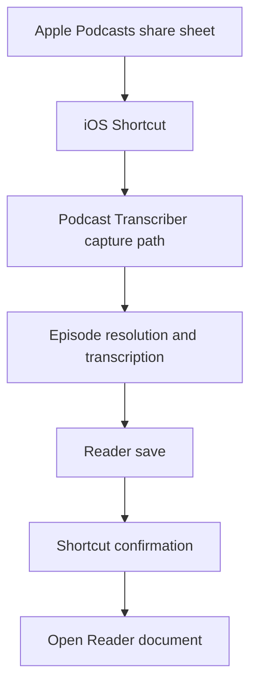

# Apple Podcasts Share to Reader - Plan

## Goal Capsule

- **Objective:** Let the listener share an Apple Podcasts episode from the iOS share sheet and have the transcript saved to Readwise Reader without opening the Podcast Transcriber browser form.
- **Product authority:** `STRATEGY.md` frames the product around reducing capture friction for Apple Podcasts transcripts saved to Readwise Reader.
- **Execution profile:** Code feature, requirements-only. Planning should enrich this artifact with the implementation design.
- **Open blockers:** Planning must choose the authentication model for capture outside the browser form, the synchronous versus asynchronous completion shape, and the URL canonicalization rules for duplicate saves.

---

## Product Contract

### Summary

Add a share-sheet capture path that accepts an Apple Podcasts episode URL from iOS, transcribes the episode, saves the transcript to Reader, and returns a Reader document link when available.
This first slice is only about transcript saving; highlight capture, selected transcript text, and timestamp inference stay deferred.

### Problem Frame

The current workflow requires the listener to stop in Apple Podcasts, copy the episode URL, open Podcast Transcriber in a browser, paste the URL, wait for transcription, manually save to Reader, then open Reader.
That flow works, but it interrupts the listening context at the exact moment the user wants capture to be lightweight.
The first useful reduction is moving the full-transcript save behind the Apple Podcasts share sheet so the user can keep the capture action near the listening moment.

### Key Decisions

- **Transcript saving first.** The v1 product value is removing the browser paste and manual Reader-save steps; highlight semantics are a separate product slice.
- **Reader remains the destination.** A successful capture should leave the user with an openable Reader document, not a new Podcast Transcriber inbox to manage.
- **Share sheet augments the web form.** The existing pasted-URL flow should remain available while the share-sheet rail becomes the lower-friction path.
- **Confirmation over silence.** The user should receive visible feedback from the Shortcut flow; if the save cannot complete quickly, a started/status result is preferable to an opaque wait.

### Actors

- A1. Listener: the person listening in Apple Podcasts and sending an episode to Reader.
- A2. Apple Podcasts: the source app that provides the shared episode URL or text.
- A3. iOS Shortcut: the user-installed capture rail that receives share-sheet input and calls Podcast Transcriber.
- A4. Podcast Transcriber: the service that resolves the episode, transcribes it, and saves it to Reader.
- A5. Readwise Reader: the destination where the transcript becomes a document.

### Requirements

**Share intake**

- R1. The share-sheet capture path accepts an Apple Podcasts episode URL from iOS without requiring the user to open the Podcast Transcriber web form.
- R2. If the shared input does not resolve to a supported Apple Podcasts episode, the user receives a clear failure outcome and no Reader document is created.
- R3. The existing browser form remains available for manual Apple Podcasts URL submission.

**Transcript and Reader save**

- R4. A supported shared episode produces a Reader document containing the generated transcript and relevant episode metadata.
- R5. A successful save returns a Reader document URL when Reader provides one.
- R6. Re-sharing the same canonical episode URL should resolve to the same Reader document whenever Reader deduplication and local URL normalization allow it.
- R7. The v1 save flow does not create highlights, captured-highlight markers, timestamp-specific transcript edits, or Readwise highlight objects.

**User feedback**

- R8. A completed save produces Shortcut-visible confirmation that the transcript was saved to Reader.
- R9. When a Reader URL is available, the confirmation gives the user a way to open the Reader document.
- R10. If transcription or saving cannot complete quickly, the user receives a started/status outcome rather than waiting without feedback.
- R11. Failure feedback distinguishes the broad cause enough for action: unsupported input, transcription failure, missing or invalid Reader access, or Reader save failure.

**Setup and measurement**

- R12. The capture path does not require the user to re-enter their Readwise token on every share.
- R13. The share-sheet path is tracked separately enough to compare capture success and failure against the current browser-form funnel.

### Key Flows

- F1. Share and save
  - **Trigger:** A1 shares an Apple Podcasts episode to A3.
  - **Actors:** A1, A2, A3, A4, A5
  - **Steps:** A3 sends the shared input to A4. A4 validates the episode, generates the transcript, saves it to A5, and returns the Reader result. A3 confirms the outcome to A1.
  - **Outcome:** A1 has the episode transcript saved in Reader and can open the document when a link is available.
  - **Covered by:** R1, R4, R5, R8, R9

- F2. Duplicate episode share
  - **Trigger:** A1 shares an episode that has already been saved with the same canonical URL.
  - **Actors:** A1, A3, A4, A5
  - **Steps:** A4 uses the canonical episode URL for the Reader save. A5 returns the existing document when its deduplication recognizes the URL.
  - **Outcome:** A1 gets the Reader document link without a confusing second transcript document for the same episode.
  - **Covered by:** R5, R6

- F3. Slow or incomplete capture
  - **Trigger:** A4 cannot finish transcription and Reader save inside the expected Shortcut wait.
  - **Actors:** A1, A3, A4
  - **Steps:** A4 returns a started/status outcome. A3 shows confirmation that capture began instead of leaving A1 with no signal.
  - **Outcome:** A1 knows whether the capture was accepted and where to check next.
  - **Covered by:** R10, R11

### Acceptance Examples

- AE1. **Covers R1, R4, R5, R8, R9.** Given a supported Apple Podcasts episode is shared from iOS, when the capture completes, then the transcript is saved in Reader and the user sees confirmation with the Reader link when available.
- AE2. **Covers R2, R11.** Given the shared input is not a supported Apple Podcasts episode, when the Shortcut sends it to Podcast Transcriber, then the user sees an unsupported-input failure and no Reader save is attempted.
- AE3. **Covers R6.** Given the same canonical episode URL has already been saved, when the user shares it again, then the flow returns or reuses the same Reader document when Reader recognizes the duplicate URL.
- AE4. **Covers R7.** Given an episode is shared without selected transcript text, when the v1 flow succeeds, then it saves the transcript only and does not attempt to create a highlight.
- AE5. **Covers R10, R11.** Given transcription runs longer than the Shortcut completion window, when the capture request is accepted, then the user receives a started/status outcome rather than a silent spinner.

### Success Criteria

- Sharing a supported Apple Podcasts episode can save a transcript to Reader without manually opening Podcast Transcriber in a browser.
- The user receives visible success or failure feedback from the share-sheet flow.
- Repeated shares of the same normalized episode URL avoid duplicate Reader documents when Reader deduplication permits.
- The existing browser form continues to support the current paste-transcribe-save workflow.
- No highlight behavior is introduced in this slice.

### Scope Boundaries

Deferred for later:

- Selected transcript text as a Reader highlight.
- Timestamp inference from current podcast playback position.
- Automatic insight detection around the listening moment.
- Readwise highlight object creation.
- Reader document note ledgers or captured-highlight markers.
- Source apps beyond Apple Podcasts.
- Destinations beyond Readwise Reader.
- Native push notifications after background completion, unless planning finds they are the simplest reliable way to satisfy R10.

### Dependencies and Assumptions

- Apple Shortcuts can receive input from another app through the share sheet, including URLs and text.
- Apple Shortcuts can call web APIs and send JSON request bodies.
- Apple Shortcuts can show system notifications during a Shortcut run.
- Reader's save API can create a document from supplied URL, HTML, title, author, image, and published-date fields, and returns a Reader URL.
- Reader can return an existing document for a repeated save when the URL matches, but different URL variants can still create duplicates.
- The current repo already has primitives for Apple Podcasts URL resolution, transcription, metadata extraction, and Reader save, but the product wiring is browser-form-first.
- The current browser token model stores the Readwise token in localStorage, so a share-sheet capture path needs a setup/authentication shape that works outside that page.

### Outstanding Questions

Deferred to planning:

- Should v1 wait synchronously for transcription and save when fast, or should every share create a short status flow?
- Where should the Readwise access token live for the share-sheet path?
- What URL normalization is enough for Apple Podcasts episode deduplication without risking incorrect merges?
- What exact timeout separates a completed-save notification from a started/status notification?
- Which analytics events should be added or extended for share-sheet capture?

### Sources and Research

- `STRATEGY.md` defines the current Apple Podcasts to Readwise Reader scope and the frictionless capture track.
- `app/actions.ts` already contains Apple episode resolution, Deepgram transcription, metadata extraction, and Reader save primitives.
- `app/components/DownloadForm.tsx` currently wires those primitives to a pasted-URL browser flow and a manual Save to Reader button.
- `EVENTS.md` defines the current transcription and Reader-save event taxonomy.
- Apple Shortcuts documentation confirms that shortcuts launched from other apps can receive URL or text input, call web APIs, and show system notifications.
- Readwise Reader API documentation confirms document creation via `POST /api/v3/save/`, response URLs, and `200` responses for existing documents.
- Reader parsing documentation confirms same-URL deduplication and notes that different URL variants can create duplicate documents.
