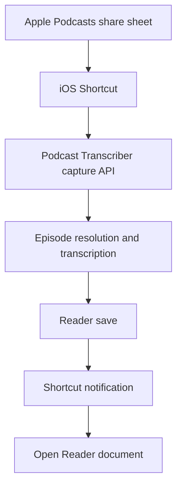
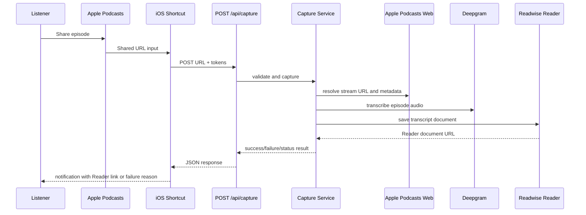

# Apple Podcasts Share to Reader - Plan

## Goal Capsule

- **Objective:** Let the listener share an Apple Podcasts episode from the iOS share sheet and have the transcript saved to Readwise Reader without opening the Podcast Transcriber browser form.
- **Strategy anchor:** `STRATEGY.md` frames the product around reducing capture friction between hearing something useful in Apple Podcasts and saving source material to Readwise Reader.
- **Execution profile:** Code feature. This plan is implementation-ready and should be executed as one focused feature branch.
- **Product-contract note:** The brainstorm scope is preserved, with one confirmed clarification: v1 uses a synchronous-first capture request and returns explicit success, failure, or timeout/status feedback. Durable background completion is deferred unless implementation validation proves the synchronous-first path unreliable.
- **Stop conditions:** Pause implementation and re-plan if Apple Podcasts does not provide a usable shared URL, if a Shortcut cannot send the required authenticated POST request, if deployed request duration cannot support normal transcript saves, or if Reader cannot return/open a document URL for successful saves.

---

## Product Contract

### Summary

Add a share-sheet capture path that accepts an Apple Podcasts episode URL from iOS, transcribes the episode, saves the transcript to Reader, and returns a Reader document link when available.
This first slice is only about transcript saving; highlight capture, selected transcript text, and timestamp inference stay deferred.

### Problem Frame

The current workflow requires the listener to stop in Apple Podcasts, copy the episode URL, open Podcast Transcriber in a browser, paste the URL, wait for transcription, manually save to Reader, then open Reader.
That flow works, but it interrupts the listening context at the exact moment the user wants capture to be lightweight.
The first useful reduction is moving the full-transcript save behind the Apple Podcasts share sheet so the user can keep the capture action near the listening moment.

### Key Decisions

- **Transcript saving first.** The v1 product value is removing the browser paste and manual Reader-save steps; highlight semantics are a separate product slice.
- **Reader remains the destination.** A successful capture should leave the user with an openable Reader document, not a new Podcast Transcriber inbox to manage.
- **Share sheet augments the web form.** The existing pasted-URL flow should remain available while the share-sheet rail becomes the lower-friction path.
- **Confirmation over silence.** The user should receive visible feedback from the Shortcut flow; if the save cannot complete inside the synchronous wait budget, v1 returns a clear timeout/status result rather than running hidden background work.

### Actors

- A1. Listener: the person listening in Apple Podcasts and sending an episode to Reader.
- A2. Apple Podcasts: the source app that provides the shared episode URL or text.
- A3. iOS Shortcut: the user-installed capture rail that receives share-sheet input and calls Podcast Transcriber.
- A4. Podcast Transcriber: the service that resolves the episode, transcribes it, and saves it to Reader.
- A5. Readwise Reader: the destination where the transcript becomes a document.

### Requirements

**Share Intake**

- R1. The share-sheet capture path accepts an Apple Podcasts episode URL from iOS without requiring the user to open the Podcast Transcriber web form.
- R2. If the shared input does not resolve to a supported Apple Podcasts episode, the user receives a clear failure outcome and no Reader document is created.
- R3. The existing browser form remains available for manual Apple Podcasts URL submission.

**Transcript And Reader Save**

- R4. A supported shared episode produces a Reader document containing the generated transcript and relevant episode metadata.
- R5. A successful save returns a Reader document URL when Reader provides one.
- R6. Re-sharing the same canonical episode URL should resolve to the same Reader document whenever Reader deduplication and local URL normalization allow it.
- R7. The v1 save flow does not create highlights, captured-highlight markers, timestamp-specific transcript edits, or Readwise highlight objects.

**User Feedback**

- R8. A completed save produces Shortcut-visible confirmation that the transcript was saved to Reader.
- R9. When a Reader URL is available, the confirmation gives the user a way to open the Reader document.
- R10. If transcription or saving cannot complete inside the chosen synchronous wait budget, the user receives a clear timeout/status outcome rather than waiting without feedback; durable background completion is not required for v1.
- R11. Failure feedback distinguishes the broad cause enough for action: unsupported input, transcription failure, missing or invalid Reader access, or Reader save failure.

**Setup And Measurement**

- R12. The capture path does not require the user to re-enter their Readwise token on every share.
- R13. The share-sheet path is tracked separately enough to compare capture success and failure against the current browser-form funnel.

### Key Flows

- F1. Share and save
  - **Trigger:** A1 shares an Apple Podcasts episode to A3.
  - **Actors:** A1, A2, A3, A4, A5
  - **Steps:** A3 sends the shared input to A4. A4 validates the episode, generates the transcript, saves it to A5, and returns the Reader result. A3 confirms the outcome to A1.
  - **Outcome:** A1 has the episode transcript saved in Reader and can open the document when a link is available.
  - **Covered by:** R1, R4, R5, R8, R9

- F2. Duplicate episode share
  - **Trigger:** A1 shares an episode that has already been saved with the same canonical URL.
  - **Actors:** A1, A3, A4, A5
  - **Steps:** A4 uses the canonical episode URL for the Reader save. A5 returns the existing document when its deduplication recognizes the URL.
  - **Outcome:** A1 gets the Reader document link without a confusing second transcript document for the same episode.
  - **Covered by:** R5, R6

- F3. Slow or incomplete capture
  - **Trigger:** A4 cannot finish transcription and Reader save inside the expected Shortcut wait.
  - **Actors:** A1, A3, A4
  - **Steps:** A4 returns a timeout/status outcome that is clear about whether the request failed, should be retried, or needs a later async design. A3 shows confirmation instead of leaving A1 with no signal.
  - **Outcome:** A1 knows the capture did not silently vanish.
  - **Covered by:** R10, R11

### Acceptance Examples

- AE1. **Covers R1, R4, R5, R8, R9.** Given a supported Apple Podcasts episode is shared from iOS, when the capture completes, then the transcript is saved in Reader and the user sees confirmation with the Reader link when available.
- AE2. **Covers R2, R11.** Given the shared input is not a supported Apple Podcasts episode, when the Shortcut sends it to Podcast Transcriber, then the user sees an unsupported-input failure and no Reader save is attempted.
- AE3. **Covers R6.** Given the same canonical episode URL has already been saved, when the user shares it again, then the flow returns or reuses the same Reader document when Reader recognizes the duplicate URL.
- AE4. **Covers R7.** Given an episode is shared without selected transcript text, when the v1 flow succeeds, then it saves the transcript only and does not attempt to create a highlight.
- AE5. **Covers R10, R11.** Given transcription runs longer than the Shortcut completion window, when the capture request reaches Podcast Transcriber, then the user receives a timeout/status outcome rather than a silent spinner or hidden background promise.

### Success Criteria

- Sharing a supported Apple Podcasts episode can save a transcript to Reader without manually opening Podcast Transcriber in a browser.
- The user receives visible success or failure feedback from the share-sheet flow.
- Repeated shares of the same normalized episode URL avoid duplicate Reader documents when Reader deduplication permits.
- The existing browser form continues to support the current paste-transcribe-save workflow.
- No highlight behavior is introduced in this slice.

---

## Planning Contract

### Technical Summary

Build a server-side capture service that both the existing browser actions and a new Shortcut-facing API route can use.
The Shortcut receives an Apple Podcasts URL from the iOS share sheet, sends it to the API with a capture secret and the user's Readwise token, waits for a bounded synchronous response, and shows a notification that either opens Reader or explains the failure/status.

### Key Technical Decisions

- KTD1. **Use a Next.js Route Handler for the share target.** Add a `POST` route under `app/api/capture/route.ts` because Shortcuts can call web APIs with JSON bodies, and Next route handlers are the repo-native way to expose a non-UI POST endpoint.
- KTD2. **Extract shared capture orchestration from `app/actions.ts`.** Move Apple URL validation, canonicalization, episode resolution, transcription, Reader HTML generation, and Reader save into server-only library modules so the browser form and Shortcut route do not drift.
- KTD3. **Keep v1 authentication personal and lightweight.** Require the Shortcut to send a server capture secret plus the user's Readwise token on each request. Do not add user accounts, OAuth, token persistence, or a database in this slice.
- KTD4. **Preserve the current browser token model.** The browser form can keep using `localStorage` for the Readwise token; only its server action plumbing should change to use the shared service.
- KTD5. **Canonicalize Apple Podcasts episode URLs before saving to Reader.** Prefer the episode URL from parsed metadata when it is a supported Apple Podcasts URL; otherwise normalize the shared URL by removing hash and tracking query noise while preserving the episode identity. Use that canonical URL for the Reader `url` field.
- KTD6. **Use synchronous-first completion with a bounded wait.** The route should normally return a Reader URL after the transcript save. If work exceeds the configured budget or a dependency fails, return a structured timeout/status or failure result; do not create an unobservable background job in v1.
- KTD7. **Return Shortcut-friendly JSON.** The API response should contain a stable status, a short notification title/body, an optional Reader URL, and a broad failure category. The Shortcut should not need to infer product state from raw exception text.
- KTD8. **Escape transcript HTML before sending it to Reader.** The existing save path constructs HTML from transcript strings; the shared Reader-save helper should escape transcript text before wrapping it in paragraphs.
- KTD9. **Track share-sheet capture on the server.** Extend the current Vercel analytics taxonomy with server-side capture events, because Shortcut traffic will not run client-side `track()` calls.
- KTD10. **Add focused test tooling.** The repo currently has lint/build scripts but no test runner. Add a minimal Vitest setup for service and route behavior rather than relying on manual Shortcut testing alone.

### Module Shape

- `lib/apple-podcasts.ts`: Apple Podcasts URL validation, canonicalization, metadata extraction support, stream URL extraction helpers.
- `lib/readwise.ts`: Reader payload creation, transcript HTML escaping, token-authenticated save call, Reader error classification.
- `lib/podcast-capture.ts`: top-level orchestration for resolve, transcribe, save, analytics result mapping, and timeout/status handling.
- `app/api/capture/route.ts`: Shortcut-facing POST adapter for auth, request parsing, response status codes, and JSON response shape.
- `app/actions.ts`: browser-form server actions that delegate to the shared service modules while preserving the current UI contract.
- `app/types.ts` or `lib/capture-types.ts`: shared response and error-category types used by the route, actions, and tests.
- `EVENTS.md`: updated event names and properties for browser versus Shortcut capture paths.
- `docs/shortcuts/apple-podcasts-to-reader.md`: setup and manual smoke-test guide for the user-installed Shortcut.

### API Contract

- Endpoint: `POST /api/capture`
- Runtime: Node.js runtime, because the capture path depends on server-side packages and environment variables already used by `app/actions.ts`.
- Request source: an iOS Shortcut using "Get Contents of URL" with a JSON request body.
- Request authentication: a capture secret checked by the API route and a Readwise access token used only for the outgoing Reader API call.
- Minimum request fields: shared Apple Podcasts URL, Readwise token, capture secret.
- Success response: status `saved`, Reader document URL when returned by Reader, user-facing notification copy, and normalized episode metadata where safe.
- Non-success response: status `failed` or `timeout`, plus one broad category such as `unsupported_input`, `missing_capture_auth`, `missing_reader_token`, `invalid_reader_token`, `transcription_failed`, `reader_save_failed`, `timeout`, or `unexpected_error`.
- Response-code guidance: use `200` for saved and user-actionable known failures that the Shortcut should display, `400` for malformed requests, `401` for missing/invalid capture auth, and `500` only for unexpected server failures.

### Shortcut Contract

- Configure the Shortcut to accept URL input from the share sheet.
- Convert the shared input to a URL or text value and send it to `POST /api/capture`.
- Store the Readwise token and capture secret as Shortcut setup values so the user does not re-enter them on every share.
- Show a system notification for the returned result.
- If `readerUrl` is present, offer an "Open URL" step to jump to the Reader document after notification.
- If the response is unsupported, auth-related, timeout, transcription failure, or Reader failure, show the API-provided short explanation.

### Data And Auth Assumptions

- The Readwise token is user-owned and already obtainable from Readwise.
- The capture secret protects the public endpoint from casual unauthenticated use; it is not a multi-user authorization system.
- The API route must never log the Readwise token or capture secret.
- The server continues to own the Deepgram API key through `DEEPGRAM_API_KEY`.
- No persistent application database is added in this slice.
- Reader dedupe is best-effort and depends on an exact or Reader-recognized URL match; local canonicalization reduces but cannot eliminate duplicate-document risk.

### Analytics Contract

Extend `EVENTS.md` with server-side events for the Shortcut rail:

- `share_capture`: emitted when the Shortcut route receives a supported request; properties include `source: "shortcut"`, `status`, and broad `failure_type` when applicable.
- `share_capture_save`: emitted after Reader save success or failure; properties include `source: "shortcut"`, `status`, and `reader_url_available`.
- Preserve existing browser events (`episode_transcribe`, `transcript_save`, `token_show_dialog`, `token_store`, `transcript_click_link`) and add `source: "browser"` only if doing so does not break existing dashboard continuity.

### Timeout Contract

- Choose a first implementation budget that is lower than the deployed function/request limit and practical for Shortcuts to wait on.
- Wrap the orchestration in a timeout guard so the API can return a controlled `timeout` category instead of leaving the Shortcut request hanging.
- If manual validation shows normal podcast episodes regularly exceed the wait budget, stop and revise the plan toward a durable async job/status design before shipping.

---

## Implementation Units

### U1. Add Minimal Test Harness

**Goal:** Make the new server-side capture behavior testable before extraction and route work.

**Files:**

- `package.json`
- `package-lock.json`
- `vitest.config.mts`
- `test/setup.ts` if needed for shared mocks

**Work:**

- Add Vitest and Next-compatible test configuration using the project package manager and lockfile.
- Add `npm test` or `npm run test` support while keeping existing `dev`, `build`, `start`, and `lint` scripts.
- Configure path aliases so tests can import `@/lib/...` and app modules consistently with `tsconfig.json`.

**Verification:**

- `npm run lint`
- `npm run build`
- `npm run test -- --run`

**Requirements covered:** Enables coverage for R1-R13.

### U2. Extract Shared Server-Side Capture Services

**Goal:** Move the existing browser-first primitives into reusable server-side modules without changing behavior.

**Files:**

- `app/actions.ts`
- `app/types.ts`
- `lib/apple-podcasts.ts`
- `lib/readwise.ts`
- `lib/podcast-capture.ts`
- `__tests__/apple-podcasts.test.ts`
- `__tests__/readwise.test.ts`
- `__tests__/podcast-capture.test.ts`

**Work:**

- Extract Apple Podcasts URL validation and canonicalization from `DownloadForm`/`actions.ts` into `lib/apple-podcasts.ts`.
- Extract Apple metadata parsing and stream URL resolution helpers from `app/actions.ts`.
- Extract Reader request construction into `lib/readwise.ts`, including HTML escaping for transcript paragraphs.
- Add an orchestration function that accepts an Apple episode URL and Readwise token, then resolves metadata, resolves audio, transcribes, and saves to Reader.
- Keep thrown errors or result categories broad and product-facing: unsupported input, transcription failure, Reader auth failure, Reader save failure, timeout, and unexpected failure.

**Tests:**

- Apple URL validation accepts supported `podcasts.apple.com` episode URLs and rejects non-Apple/non-episode input.
- Canonicalization strips hash/tracking noise without removing episode identity.
- Reader HTML generation escapes transcript text and wraps paragraphs predictably.
- Reader save maps `200` and `201` responses with `url` to success.
- Reader auth/save failures map to the planned broad categories.
- Capture orchestration calls dependencies in order and does not attempt Reader save after unsupported input or transcription failure.

**Requirements covered:** R2, R4, R5, R6, R7, R11, R12.

### U3. Add Shortcut Capture API Route

**Goal:** Expose the shared capture service to iOS Shortcuts through a stable POST endpoint.

**Files:**

- `app/api/capture/route.ts`
- `app/types.ts` or `lib/capture-types.ts`
- `lib/podcast-capture.ts`
- `__tests__/capture-route.test.ts`

**Work:**

- Add `POST /api/capture` as the Shortcut-facing route.
- Parse JSON request bodies and validate the shared URL, Readwise token, and capture secret.
- Compare the capture secret against a server environment variable.
- Call the shared capture orchestration with a timeout guard.
- Return Shortcut-friendly JSON with status, notification copy, optional Reader URL, and failure category.
- Ensure sensitive values are not returned, tracked, or logged.

**Tests:**

- Missing/invalid capture secret returns the planned auth failure and does not call capture orchestration.
- Missing Readwise token returns a clear Reader-token failure.
- Unsupported Apple input returns a clear unsupported-input result and no Reader save.
- Successful capture returns `saved` with Reader URL and notification copy.
- Timeout returns `timeout` with Shortcut-displayable copy.
- Unexpected errors return a controlled generic failure without leaking secrets.

**Requirements covered:** R1, R2, R4, R5, R7, R8, R9, R10, R11, R12.

### U4. Preserve And Rewire The Browser Flow

**Goal:** Keep the existing pasted-URL workflow working while it shares the new service layer.

**Files:**

- `app/actions.ts`
- `app/components/DownloadForm.tsx`
- `app/types.ts`
- `__tests__/browser-actions.test.ts` if action-level tests are practical

**Work:**

- Update `app/actions.ts` to call the extracted Apple, transcription, and Reader helpers.
- Preserve the existing `DownloadForm` behavior: URL paste, auto-transcription, manual Save to Reader, token dialog, and success toast with Reader link.
- Keep the current browser-side validation or replace it with the shared validation in a way that does not loosen supported input.
- Make browser and Shortcut errors use the same broad categories internally, while preserving the current UI copy unless a copy change is necessary.

**Tests:**

- Existing server action response shapes remain compatible with `DownloadForm`.
- Browser Reader save still sends metadata, transcript HTML, and token to the shared Reader helper.
- Invalid pasted input is still rejected before unnecessary downstream calls.

**Requirements covered:** R3, R4, R5, R7, R11, R12.

### U5. Add Shortcut Setup Documentation And Manual Fixture

**Goal:** Make the share-sheet workflow reproducible on the user's iPhone without requiring source-code spelunking.

**Files:**

- `docs/shortcuts/apple-podcasts-to-reader.md`
- `README.md` if a short link to the Shortcut guide is useful

**Work:**

- Document the one-time setup: deployed app URL, capture secret, Readwise token, accepted share input type, POST request body, and notification/open-URL steps.
- Include the expected success, unsupported-input, auth failure, timeout, transcription failure, and Reader failure outcomes.
- Include a small manual test matrix for supported episode, duplicate episode, unsupported URL, missing token, and invalid capture secret.
- Keep highlight/timestamp behavior explicitly out of the Shortcut guide.

**Verification:**

- Follow the document against the local or deployed app enough to confirm the described Shortcut fields match the implemented API contract.

**Requirements covered:** R1, R2, R8, R9, R10, R11, R12.

### U6. Add Server-Side Analytics And Event Documentation

**Goal:** Measure the Shortcut rail separately from the browser funnel.

**Files:**

- `app/api/capture/route.ts`
- `lib/podcast-capture.ts`
- `EVENTS.md`
- `__tests__/capture-route.test.ts` or `__tests__/analytics.test.ts`

**Work:**

- Import server-side Vercel analytics where appropriate for route/server action usage.
- Track route received, capture saved, and capture failed outcomes with `source: "shortcut"`.
- Keep event properties low-cardinality and non-sensitive.
- Update `EVENTS.md` with the new events and any changed browser event properties.

**Tests:**

- Analytics calls are made for success and known failure paths when the analytics helper is available.
- Tokens, URLs with sensitive query strings, and raw exception messages are not included in analytics payloads.

**Requirements covered:** R13, plus observability for R1-R12.

---

## Verification Contract

### Automated Verification

- `npm run lint`
- `npm run build`
- `npm run test -- --run`

### Manual Verification

- Supported share: share a real Apple Podcasts episode URL into the Shortcut, confirm the transcript saves to Reader, confirm the notification appears, and confirm the Reader URL opens.
- Duplicate share: share the same episode again and confirm Reader returns or opens the same document when URL dedupe recognizes it.
- Browser regression: paste the same supported Apple Podcasts URL into the existing web form, transcribe it, and save to Reader.
- Unsupported input: share or POST a non-Apple URL and confirm no Reader save is attempted.
- Missing/invalid Readwise token: confirm the Shortcut-visible failure identifies Reader access as the problem.
- Invalid capture secret: confirm the route rejects the request without attempting transcription or Reader save.
- Timeout scenario: force or simulate a timeout and confirm the Shortcut receives a controlled timeout/status response.

### Launch Evidence To Capture

- Test command outputs.
- A redacted sample API success response.
- A redacted sample API failure response.
- A note of the iOS/Shortcuts version used for manual validation.
- Confirmation that no highlight or timestamp behavior was introduced.

---

## Risks And Mitigations

- **Shortcut or hosting wait limits may be too short for full episodes.** Start sync-first, add timeout handling, and stop for an async redesign if normal episodes regularly time out.
- **Apple Podcasts page structure can change.** Keep extraction helpers isolated and covered by tests/fixtures so future breakage has a small repair surface.
- **Reader dedupe depends on URL identity.** Canonicalize locally and use metadata URL when available, but document that Reader may still create duplicates for materially different URL variants.
- **Shortcut-held tokens are personal, not multi-user auth.** Treat this as acceptable for the user's own workflow; defer accounts/OAuth until there is a broader user model.
- **Server-side analytics can fail on protected deployments.** Keep analytics non-blocking and rely on route responses/tests for functional correctness.
- **Transcript HTML can contain unexpected text.** Escape transcript paragraphs before constructing Reader HTML.

---

## Deferred To Follow-Up Work

- Selected transcript text as a Reader highlight.
- Timestamp inference from current podcast playback position.
- Automatic insight detection around the listening moment.
- Readwise highlight object creation.
- Reader document note ledgers or captured-highlight markers.
- Durable async job queue, status endpoint, and later completion notification.
- Native push notifications after background completion.
- User accounts, OAuth, hosted token storage, or multi-user setup.
- Source apps beyond Apple Podcasts.
- Destinations beyond Readwise Reader.

---

## Definition Of Done

- A supported Apple Podcasts share from iOS can create or reuse a Reader document containing the transcript.
- The Shortcut receives visible success, known failure, or timeout/status feedback.
- The response includes a Reader URL when Reader returns one, and the Shortcut guide explains how to open it.
- The existing browser paste-transcribe-save flow still works.
- Duplicate handling uses canonical Apple episode URLs and relies on Reader's documented same-URL behavior.
- The share-sheet rail has distinct server-side analytics from the browser funnel.
- Automated lint, build, and test verification pass.
- Manual Shortcut smoke checks are documented.
- No highlight, timestamp, selected-text, or automatic insight behavior ships in this slice.

---

## Sources And Research

- `STRATEGY.md` defines the current Apple Podcasts to Readwise Reader scope and the frictionless capture track.
- `app/actions.ts` already contains Apple episode resolution, Deepgram transcription, metadata extraction, and Reader save primitives.
- `app/components/DownloadForm.tsx` currently wires those primitives to a pasted-URL browser flow and a manual Save to Reader button.
- `EVENTS.md` defines the current transcription and Reader-save event taxonomy.
- [Apple Shortcuts input types](https://support.apple.com/guide/shortcuts/input-types-apd7644168e1/ios) confirms shortcuts launched from other apps can receive shared URL/text input.
- [Apple Shortcuts API requests](https://support.apple.com/guide/shortcuts/request-your-first-api-apd58d46713f/ios) confirms "Get Contents of URL" can make POST requests with JSON request bodies.
- [Apple Shortcuts notifications](https://support.apple.com/guide/shortcuts/use-the-show-notification-action-apd2175adcab/ios) confirms the Shortcut can show a system notification without blocking the rest of the shortcut.
- [Readwise Reader API](https://readwise.io/reader_api) confirms document creation via `POST /api/v3/save/`, token authentication, returned Reader URLs, rate limits, and `200` responses for existing documents.
- [Next.js Route Handlers](https://nextjs.org/docs/app/api-reference/file-conventions/route) confirms route handlers support POST methods and JSON request bodies.
- [Next.js Vitest guide](https://nextjs.org/docs/app/guides/testing/vitest) confirms the expected Vitest setup for Next projects.
- [Vercel custom events](https://vercel.com/docs/analytics/custom-events) confirms server-side custom events are available from API routes/server actions through `@vercel/analytics/server`.
